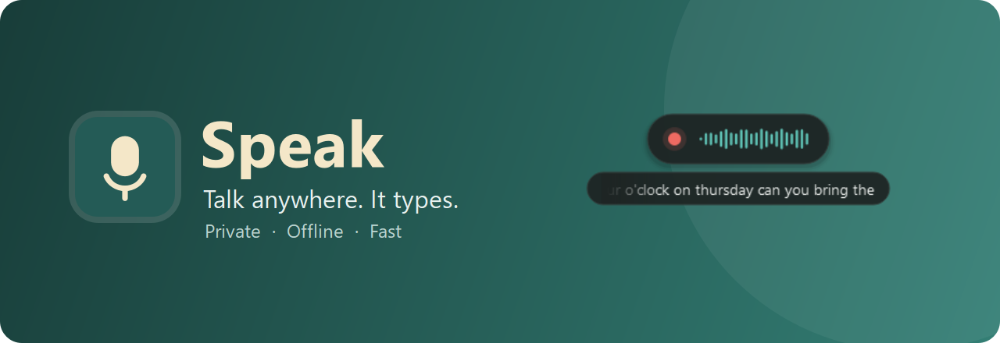
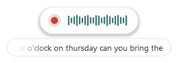
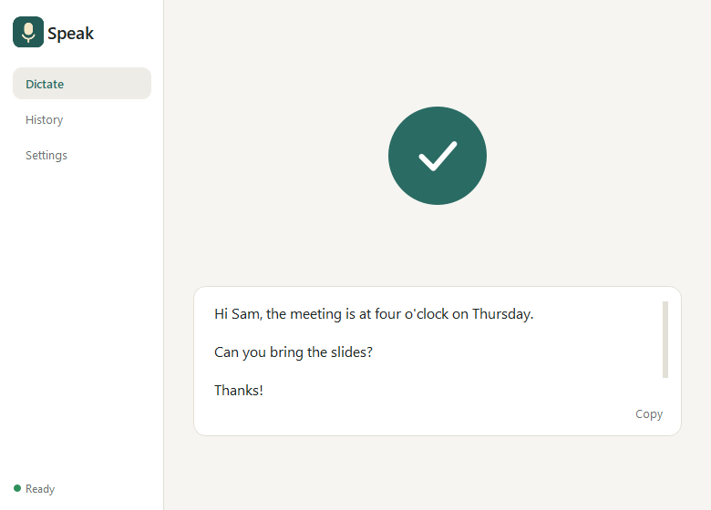
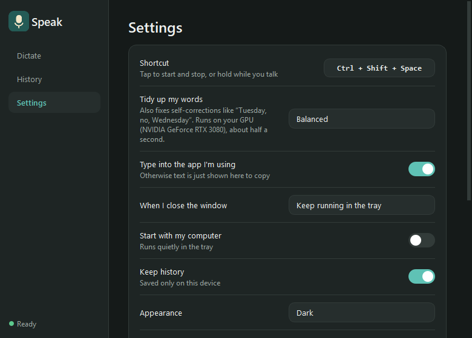

  

<h3 align="center">Talk anywhere. Speak types it for you, neatly, without your voice ever leaving your computer.</h3>

  <a href="https://github.com/jacobjmarks/speak/releases"><b>Download for Windows</b></a>
  &nbsp;·&nbsp; macOS and Linux coming soon

---

## Why Speak

**🔒 Private.** Your voice is turned into text on your own computer. No account, no cloud, nothing uploaded.

**✈️ Works offline.** After a one-time download of the speech models, Speak needs no internet at all.

**⚡ Fast.** Words appear as you talk, and tidy text lands in your app the moment you stop.

**✍️ Writes like you meant it.** Punctuation, paragraphs and capitals are added for you. Ums, ahs and repeated words disappear. Change your mind mid-sentence ("Tuesday, no, Wednesday") and Speak writes what you meant.

**🖱️ Works in any app.** Email, chat, documents, browsers. If you can type there, you can speak there.

## How it works

1. Hold **Right Alt** wherever you want to type and talk, then let go. Or *tap* it to start and stop. (You can change the shortcut.)
2. Speak. A small indicator shows it's listening, with your words appearing underneath.
3. Stop. Your text is tidied up and typed straight into the app you're using.

  

## Install

1. Download **Speak.exe** from the [latest release](https://github.com/jacobjmarks/speak/releases).
2. Run it. If Windows SmartScreen appears, choose **More info → Run anyway**.
3. Press the shortcut and start talking. The first dictation downloads the speech model (about 700 MB, once). Tidy-up models are 0.5 to 2.5 GB, chosen to suit your computer.

Speak can start with your computer and wait quietly in the system tray. You choose the first time you close the window. It keeps itself up to date (or just tells you, or doesn't check: your choice).

## Screenshots

  
  

## Make it yours

- **Your shortcut**: any key combination you like.
- **Tidy up**: *Fast* (instant), *Balanced* (recommended) or *Best*. Speak checks what your computer can handle and tells you how quick each one will be.
- **The indicator**: near your cursor, or at the top or bottom of the screen, with one sliding line of live text, the full text, or none.
- **Light or dark**, or follow your system.
- **History** stays off unless you turn it on, and is only ever kept on your device.

## Questions

**Does Speak send my voice anywhere?** No. Audio stays in memory on your computer and is discarded after each dictation. The only internet use is the one-time model download and an optional check for new versions.

**Do I need a powerful computer?** No. Speak runs on ordinary laptops. With a graphics card it can use a larger model for smarter tidying at the same speed.

**Which languages?** Speak detects the language you speak, or you can choose one in Settings → Advanced.

---

Built on open models: NVIDIA Nemotron speech recognition and Qwen for tidying up. Developers: see <a href="docs/DEVELOPMENT.md">docs/DEVELOPMENT.md</a>.

